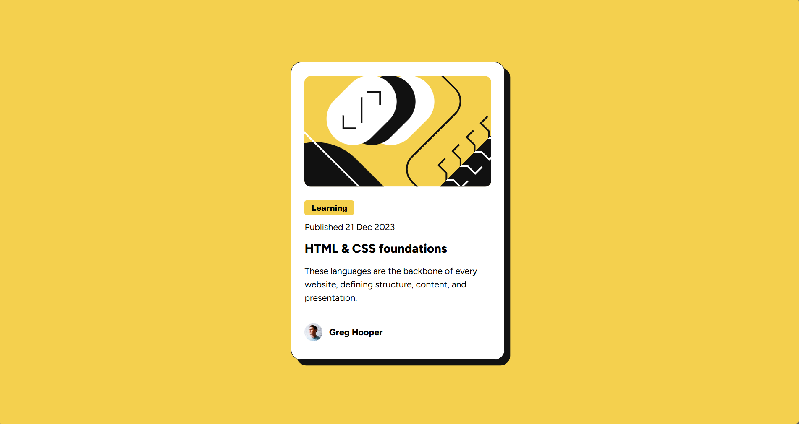

# Frontend Mentor - Blog preview card solution

This is a solution to the [Blog preview card challenge on Frontend Mentor](https://www.frontendmentor.io/challenges/blog-preview-card-ckPaj01IcS). Frontend Mentor challenges help you improve your coding skills by building realistic projects. 

## Table of contents

- [Overview](#overview)
  - [The challenge](#the-challenge)
  - [Screenshot](#screenshot)
  - [Links](#links)
- [My process](#my-process)
  - [Built with](#built-with)
  - [What I learned](#what-i-learned)
  - [Continued development](#continued-development)
- [Author](#author)

## Overview

### The challenge

Users should be able to:

- See hover and focus states for all interactive elements on the page

### Screenshot

### Links

- Solution URL: [Solution URL](https://github.com/kateemillerhd/blog_preview_card)
- Live Site URL: [Live site URL](https://kateemillerhd.github.io/blog_preview_card/)

## My process

### Built with

- Semantic HTML5 markup
- CSS custom properties
- Flexbox
- Mobile-first workflow

### What I learned

I learned the benefit of using width and max-width and letting the body position the blog card over randomly trying to use a relative position and pushing the card down from the top.  This then allows the card to actually be responsive and not need complete redo styling for different screen sizes.

### Continued development

I will continue to work on the position and sizing methods used here that I am not 100% comfortable with.

## Author

- Frontend Mentor - [@kateemillerhd](https://www.frontendmentor.io/profile/kateemillerhd)
